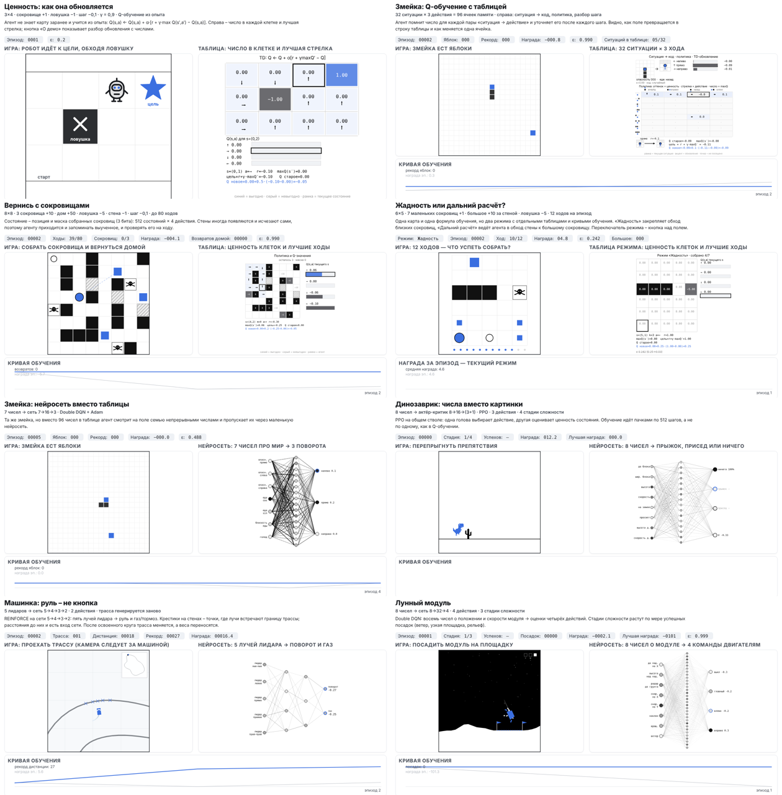
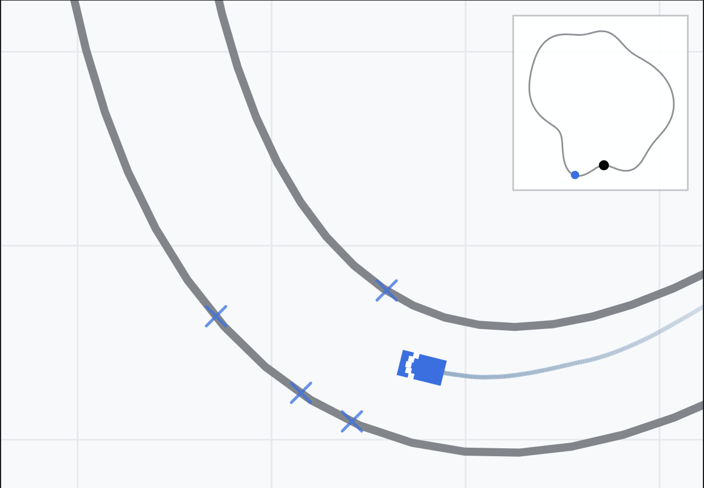

# Обучение с подкреплением: интерактивные демонстрации

Девять небольших демонстраций, в которых обучение идёт прямо в браузере: от бусинок и таблицы до нейросетей. Установка не нужна, интернет после загрузки страницы не требуется.

Материалы подготовлены к статье «Наглядность как дидактический инструмент при изучении основ обучения с подкреплением: опыт создания интерактивных материалов» (IV Международная научно-практическая конференция «Физико-математическое образование: традиции, инновации, перспективы», Минск, 19–20 ноября 2026 г.) и выросли из публичных лекций и докладов автора по обучению с подкреплением.



## Как открыть

- **Локально.** Скачайте репозиторий (Code → Download ZIP), распакуйте и откройте `index.html` двойным щелчком. Работает в Chrome, Edge, Firefox, Safari.
- **В сети.** При включённом GitHub Pages (Settings → Pages → Deploy from a branch → `main` / `(root)`) страница доступна по адресу <https://alexanderagathonov.github.io/rl-visual-demos/>.
- **Прямая ссылка на демо.** Добавьте к адресу `#ключ`, например `index.html#racing`. Ключи указаны в таблице ниже.

Переключаться между демонстрациями можно вкладками или стрелками ← → на клавиатуре.

## Что внутри

| Ключ | Демонстрация | Метод | Чему служит |
|---|---|---|---|
| `sama` | САМА: бусинки | обучение методом проб и ошибок без таблицы и сети | выбор хода как извлечение бусинки; проигрыш убирает бусинки |
| `gridworld` | Ценность в клетках | Q-обучение | как пересчитывается число в клетке: Q(s,a) ← Q(s,a) + α·[r + γ·max Q(s′,a′) − Q(s,a)] |
| `snake` | Змейка с таблицей | Q-обучение, 32 ситуации × 3 действия | ситуация → строка таблицы, разбор одного шага |
| `treasures` | Вернись с сокровищами | Q-обучение, 8×8 с динамическими стенами | состояние – позиция и маска собранных сокровищ |
| `explore` | Жадность или расчёт | Q-обучение, два режима | исследование и использование, дальний расчёт |
| `snake-dqn` | Змейка + сеть | Double DQN, сеть 7→16→3 | нейросеть вместо таблицы |
| `dino` | Динозаврик | PPO, актёр-критик 8→16→(3+1) | обучение пачками, стадии сложности |
| `racing` | Машинка | REINFORCE, сеть 5→4→3→2 | пять лучей лидара → руль и газ |
| `lander` | Лунный модуль | Double DQN, сеть 8→32→4 | восемь чисел о модуле → четыре действия |

У каждой демонстрации есть кнопки «Обучение: обычное / ускоренное», «Сброс», «Веса» (загрузка готовой модели или сохранение своей; готовые веса заложены для `dino`, `lander`, `racing`) и «О игре» с подробным описанием наград, сети и параметров.

Иллюстрация к демонстрации «Машинка»: слева – автомобиль и пять лучей лидара (крестики – точки встречи с границей трассы), справа – нейросеть с теми же пятью числами на входе. Цвета и крупные подписи добавлены для рисунка, в самой демонстрации они мельче и монохромные:



## Структура репозитория

```
index.html            страница с вкладками
assets/css/style.css  оформление
assets/js/engine.js   общий движок демонстраций
assets/js/demos/      логика каждой демонстрации (по одному файлу)
assets/js/demo-weights.js  заготовленные веса
assets/js/hub*.js     переключение вкладок
docs/                 иллюстрации для этого описания
```

Зависимостей нет: чистые HTML, CSS и JavaScript, рисование на canvas, сетевых запросов страница не делает. Если на компьютере установлен шрифт Inter, он используется, иначе – системный.

## Как цитировать

Агафонов А. А. Обучение с подкреплением: интерактивные демонстрации [Электронный ресурс]. Казань: КФУ, 2026. Режим доступа: адрес репозитория (см. `CITATION.cff`).

## Лицензия

Код – MIT (см. `LICENSE`). Тексты и иллюстрации – CC BY 4.0.

Идея демонстрации «САМА» восходит к машине MENACE Д. Мичи и к описанию М. Гарднера (Scientific American, 1962).

---

## In English

Nine small in-browser demonstrations of reinforcement learning, from a bead-and-matchbox learner and tabular Q-learning to small neural-network agents (Double DQN, PPO, REINFORCE). No installation, no network access after the page has loaded: open `index.html`. Code under the MIT license; texts and images under CC BY 4.0. Author: A. A. Agafonov, Kazan Federal University.
